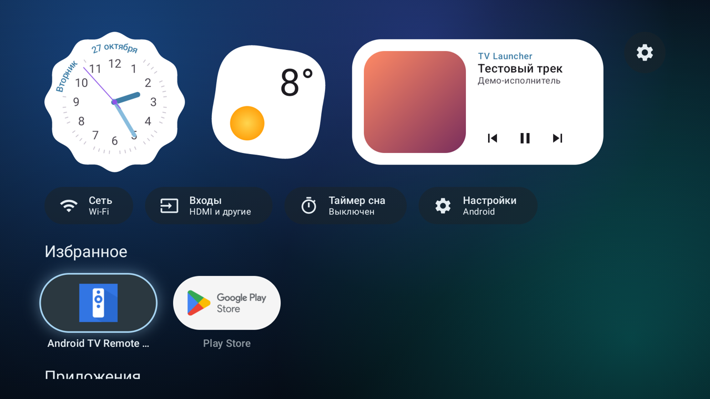
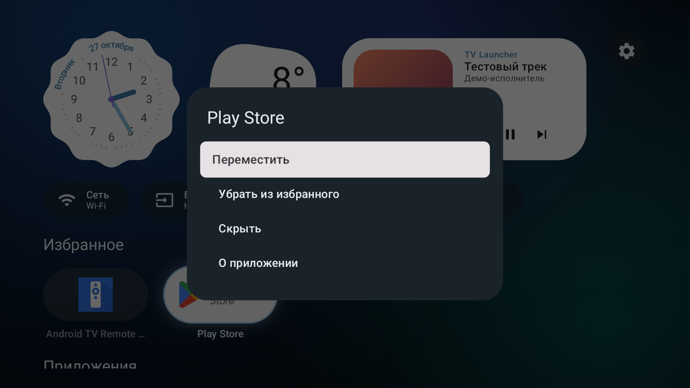
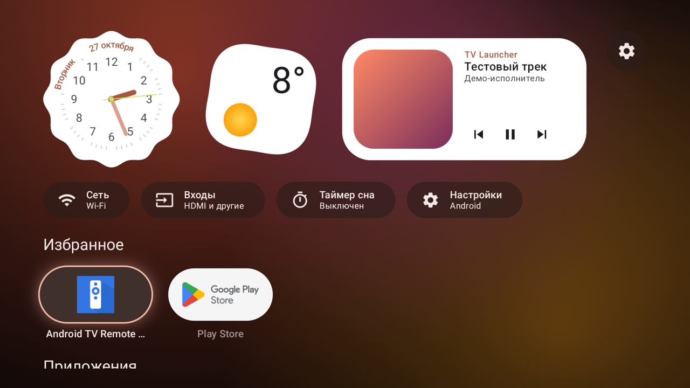
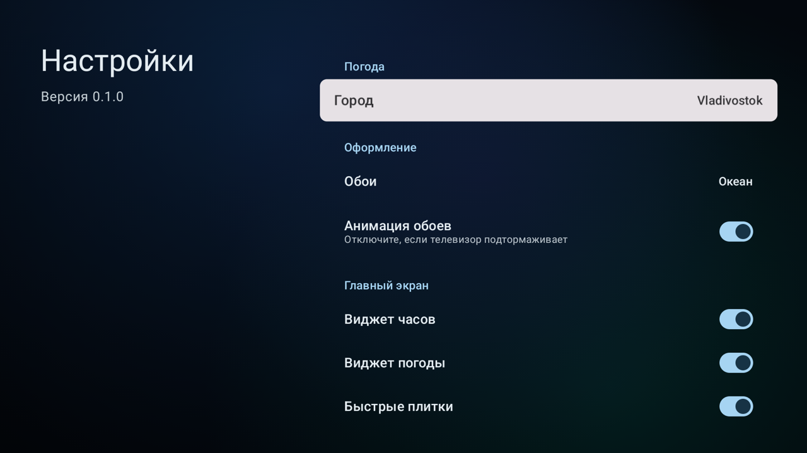
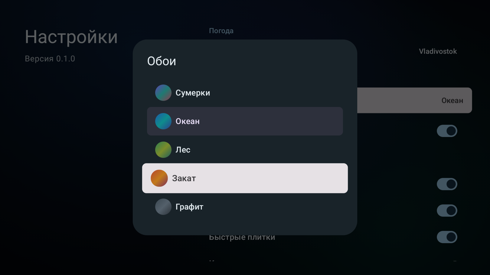
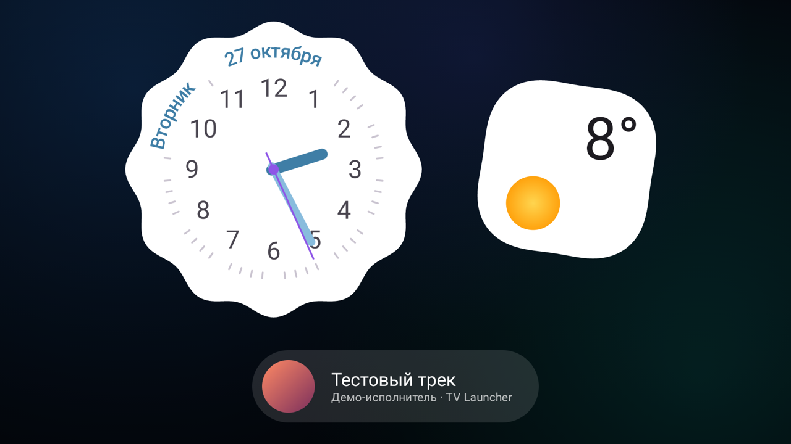

# TV Launcher

Домашний экран для Android TV в стиле Pixel: овальные карточки приложений, часы и погода как на телефоне, «Сейчас играет» с управлением музыкой и заставка. Написан на Kotlin и Compose for TV, проверялся на Яндекс ТВ (Android 11).



## Возможности

**Главный экран**
- Аналоговые часы в стиле Pixel с днём недели и датой по кругу.
- Погода по выбранному городу через [Open-Meteo](https://open-meteo.com/), без ключей и регистрации. Если Open-Meteo недоступен, данные берутся у [MET Norway](https://api.met.no/) (лицензия [CC BY 4.0](https://api.met.no/doc/License)). Город ищется по названию, по умолчанию — Арсеньев.
- «Сейчас играет»: обложка, название трека и кнопки «назад / пауза / вперёд» для Яндекс Музыки, YouTube и любого приложения с медиасессией. Если ничего не играет, а Яндекс Музыка установлена, предлагает открыть её.
- Быстрые плитки: состояние сети, входы HDMI, таймер сна, настройки Android.
- Сетка приложений с овальными карточками: баннеры TV-приложений или иконки обычных.
- Понятные состояния «нет интернета» и «нет приложений».

**Управление приложениями** (долгое нажатие OK на карточке)
- Избранное — отдельный ряд сверху.
- Перестановка стрелками пульта.
- Скрытие и возврат из списка скрытых.
- «О приложении» и удаление.

**Оформление**
- Пять обоев: Сумерки, Океан, Лес, Закат, Графит. Цвета всего интерфейса подстраиваются под обои.
- Анимация обоев, которую можно выключить, если телевизор подтормаживает.
- Плавное появление экрана; после возврата из приложения фокус стоит на нём, а не на первой карточке.

**Заставка**
- Часы, погода и играющий трек поверх приглушённых обоев.
- Раз в минуту блок смещается, чтобы не выжигать экран; с 23:00 до 7:00 заставка темнее.
- Работает и внутри лаунчера по простою, и как системная заставка Android.

**Таймер сна** — гасит экран через 15–120 минут.

Интерфейс на русском и английском, язык берётся из системы.

## Скриншоты

| | |
|---|---|
|  |  |
| Меню по долгому нажатию | Тема «Закат» |
|  |  |
| Настройки | Выбор обоев |
|  | |
| Заставка | |

Скриншоты сняты в эмуляторе; трек в «Сейчас играет» — тестовый.

## Установка на телевизор

Нужен компьютер с [Android platform-tools](https://developer.android.com/tools/releases/platform-tools) (`adb`) и включённая отладка по сети на телевизоре.

1. Подключитесь к телевизору (подставьте его IP):

   ```bash
   adb connect 192.168.1.128:5555
   ```

2. Скачайте APK из [последнего релиза](https://github.com/itsFlashLIGHT/tv-launcher/releases/latest) и установите его:

   ```bash
   adb install tv-launcher-0.1.0.apk
   ```

   Или соберите и установите из исходников: `./gradlew :app:installRelease`.

3. Назначьте лаунчер домашним экраном:

   ```bash
   adb shell cmd package set-home-activity com.flashlight.tvlauncher/.MainActivity
   ```

4. По желанию — выдайте разрешения, для которых на Яндекс ТВ нет системного окна:

   ```bash
   # «Сейчас играет»: доступ к медиасессиям других приложений
   adb shell cmd notification allow_listener com.flashlight.tvlauncher/com.flashlight.tvlauncher.data.MediaListenerService
   # Таймер сна: право гасить экран
   adb shell dpm set-active-admin com.flashlight.tvlauncher/.data.SleepAdminReceiver
   # Системная заставка
   adb shell settings put secure screensaver_components com.flashlight.tvlauncher/.ScreensaverService
   ```

Стандартную оболочку Яндекс ТВ (`com.yandex.tv.home`) **не отключайте**: она нужна прошивке. Чтобы вернуть её домашним экраном, достаточно удалить лаунчер:

```bash
adb uninstall com.flashlight.tvlauncher
```

## Сборка

- Android Studio (или JDK 17+) и Android SDK Platform 37.
- `./gradlew :app:assembleDebug` — отладочная сборка, `./gradlew :app:assembleRelease` — релизная со сжатием кода.
- Минимальная версия Android — 11 (API 30).

**Стек:** Kotlin 2.4, Jetpack Compose, [Compose for TV](https://developer.android.com/jetpack/androidx/releases/tv) (tv-material 1.1), Material 3, AndroidX Lifecycle. Сеть — `HttpURLConnection` и `org.json`, без сторонних библиотек.

### Подпись релизов

Релизы подписываются постоянным ключом, поэтому новые версии ставятся поверх старых без удаления. Ключ хранится вне репозитория, в `~/.tv-launcher/`: там лежат `release.jks` и `keystore.properties` с паролем. Gradle находит его сам; другой путь можно передать через `-PreleaseKeystore=/путь/к/keystore.properties`. Без ключа релиз соберётся с отладочной подписью, а Gradle выведет предупреждение.

Отпечаток сертификата (SHA-256):

```
65:3C:D6:C7:7A:57:4C:92:D6:DF:83:53:EE:E3:63:88:EC:CF:EC:1B:1E:C3:F7:EA:82:3A:A6:35:E5:60:A8:94
```

### Проверка в эмуляторе

Подойдёт образ Android TV (API 31). В debug-сборке есть тестовый плеер, чтобы проверить «Сейчас играет» без музыкальных приложений:

```bash
adb shell am start -n com.flashlight.tvlauncher/.MediaSessionDemoActivity
```

### Структура

```
app/src/main/java/com/flashlight/tvlauncher/
├── MainActivity.kt, HomeViewModel.kt   — экран и его состояние
├── ScreensaverService.kt               — системная заставка
├── data/   — приложения, настройки, погода, сеть, ТВ-входы, таймер сна, медиасессии
└── ui/     — главный экран, виджеты, плитки, диалоги, настройки, тема
```

---

## English

A Pixel-style home screen for Android TV built with Kotlin and Compose for TV. It has oval app cards, an analog clock and weather widget, a Now Playing card that controls Yandex Music, YouTube and other players, quick tiles (network, HDMI inputs, sleep timer, settings), favorites, reordering and hidden apps, five wallpapers that recolor the whole UI, and a screensaver that dims at night. The UI is available in English and Russian.

Download the APK from [Releases](https://github.com/itsFlashLIGHT/tv-launcher/releases/latest) or build it with `./gradlew :app:installRelease`, then make it the home app with `adb shell cmd package set-home-activity com.flashlight.tvlauncher/.MainActivity`. The optional permissions are listed in step 4 above. Requires Android 11+.
